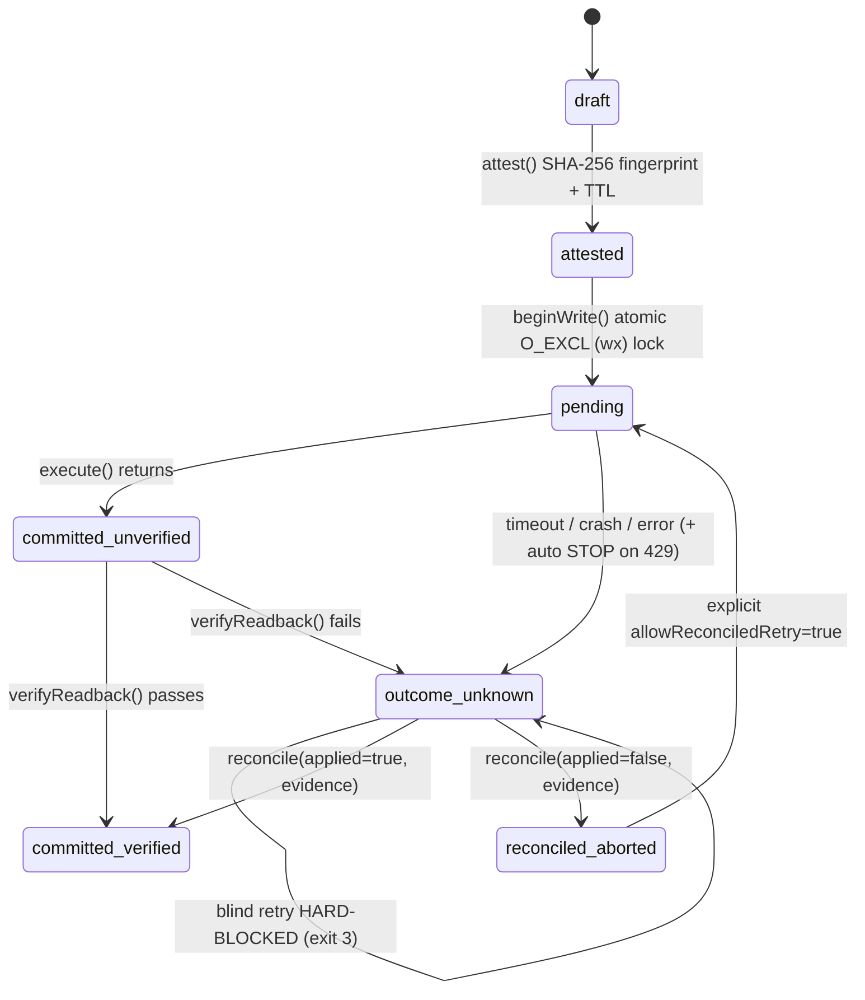

# agent-writeguard

**Why your AI agent will double-charge a customer on a 30s timeout — and how to stop it.**

Zero-dependency Node.js library & CLI harness for guarding non-idempotent AI agent writes (Stripe payouts, SaaS billing, CRM bulk updates, PR deploys, catalog publishes) with **SHA-256 dry-run attestation**, **atomic `O_EXCL` pending locks**, **mandatory read-back verification**, **daily cap rollover**, **salted tenant identity binding**, and an instant **`STOP` kill switch**.

- Zero external runtime dependencies (pure Node.js `>=20` ESM + full TypeScript `.d.ts` definitions)
- Works with **any** MCP server, Playwright/browser bot, n8n webhook, or shell agent
- Fail-closed by design: ambiguous timeouts and crashes **hard-block blind retries** until reconciled via fresh read-back

---

## The Failure Mode Every Agent Framework Ignores

An LLM tool call sends a `$1,250` payout or bulk CRM update. The remote API commits it, then a load balancer drops the TCP socket after 30 seconds (`ETIMEDOUT`).

What does a normal agent loop do?
1. Catches the timeout error.
2. Retries the tool call (often with slightly mutated arguments or a fresh generated UUID).
3. **Double-charges the customer or corrupts production state.**

Even worse, many endpoints (browser forms, legacy SaaS dashboards, third-party webhooks, multi-step workflows) do not support native idempotency keys at all.

`agent-writeguard` solves this at the execution boundary with a strict local state machine backed by OS-level `O_CREAT | O_EXCL` (`wx`) file locks.

---

## State Machine



---

## 60-Second Quickstart

### Install

```bash
npm install agent-writeguard
# or invoke the CLI directly
npx agent-writeguard --help
```

### 1. SDK Quickstart (Node.js / TypeScript / MCP)

```js
import {
  WriteGuard,
  piiLeakGuardRule,
  spendCeilingRule,
} from 'agent-writeguard';

const guard = new WriteGuard({
  stateDir: '.writeguard',
  caps: { 'stripe.payout': 5 },
  maxDailySpend: 5000,
  requireIdentity: true,
  policyRules: [
    spendCeilingRule({ maxAmount: 2500, field: 'amount', currency: 'USD' }),
    piiLeakGuardRule({ allowFields: ['recipientAccount'] }),
  ],
});

await guard.init();
await guard.bindIdentity({ identity: process.env.TENANT_ID, label: 'acme-prod' });

const payload = { invoiceId: 'inv_2026_0042', recipientAccount: 'acct_vendor_8821', amount: 1250, currency: 'USD' };

// Phase 1: Fingerprint-bound dry-run attestation (SHA-256 + 24h TTL)
const att = await guard.attest({
  action: 'stripe.payout',
  target: 'stripe:payouts',
  payload,
  ttlMs: '24h',
});

// Phase 2: Atomic O_EXCL lock -> execute -> mandatory read-back verification
const { record } = await guard.guardWrite({
  actionKey: 'payout-inv-2026-0042',
  action: 'stripe.payout',
  target: 'stripe:payouts',
  payload,
  amount: payload.amount,
  attestationId: att.attestationId,
  identity: process.env.TENANT_ID,
  execute: () => stripe.payouts.create(payload),
  verifyReadback: async () => {
    const remote = await stripe.payouts.retrieve('inv_2026_0042');
    return remote?.status === 'paid'
      ? { verified: true, evidence: { id: remote.id, status: remote.status } }
      : { verified: false, reason: 'Payout not visible in Stripe ledger' };
  },
});

console.log(record.state); // -> "committed_verified"
```

If `execute()` times out or throws mid-flight:
- The lock transitions to **`outcome_unknown`**.
- Any blind retry throws **`ERR_OUTCOME_UNKNOWN`** before `execute()` is ever called again.
- You resolve it explicitly via fresh read-back:

```js
await guard.reconcile('payout-inv-2026-0042', async () => {
  const remote = await stripe.payouts.retrieve('inv_2026_0042');
  return remote
    ? { applied: true, evidence: { id: remote.id, status: remote.status } }
    : { applied: false, evidence: 'Not found in Stripe ledger' };
});
```

### 2. CLI Quickstart (Shell Agents / n8n / CI)

```bash
# 1. Initialize state directory, daily quotas, and salted tenant identity
writeguard init --cap "deploy.release=3" --identity "org:acme:prod" --label "acme-prod"

# 2. Attest exact payload before running any side effect
ATT_ID=$(writeguard attest \
  --action "deploy.release" \
  --target "n8n:webhook/deploy-prod" \
  --payload '{"service":"billing-api","version":"2.14.0"}' \
  --ttl 2h --json | node -e "console.log(JSON.parse(require('fs').readFileSync(0,'utf8')).attestationId)")

# 3. Execute under atomic O_EXCL lock + mandatory read-back verification command
writeguard guard \
  --key "deploy-billing-2.14.0" \
  --action "deploy.release" \
  --target "n8n:webhook/deploy-prod" \
  --attestation "$ATT_ID" \
  --identity "org:acme:prod" \
  --payload '{"service":"billing-api","version":"2.14.0"}' \
  --verify-cmd "curl -fsS https://api.acme.io/version | grep -q 2.14.0" \
  -- ./scripts/trigger-deploy.sh

# 4. If a command times out (exit code 3), inspect & reconcile before retrying
writeguard status
writeguard reconcile --key "deploy-billing-2.14.0" --applied --evidence "Version 2.14.0 live on prod" --operator "sre"
```

---

## Comparison: Why Basic Retries Are Not Enough

| Capability | Basic Retry Loop | Prompt-Only Guardrails | API Idempotency Keys Alone | **`agent-writeguard`** |
|---|---|---|---|---|
| Prevents payload drift between dry-run & live | No | No | No | **Yes (SHA-256 + TTL)** |
| Blocks concurrent duplicate runs across processes | No | No | API-dependent | **Yes (OS `O_EXCL` lock)** |
| Hard-blocks blind retries after 30s timeout | No (retries!) | No | Only if key reused & supported | **Yes (`outcome_unknown`)** |
| Enforces external read-back before commit | No | No | No | **Yes (`verifyReadback`)** |
| Works on browser/Playwright/webhook/legacy targets | Yes (unsafe) | Yes (unsafe) | No | **Yes (CLI + SDK + MCP)** |
| Auto-trips `STOP` kill switch on HTTP 429 / spend limit | No | No | No | **Yes (local `STOP` file)** |
| Salted cross-tenant identity check | No | No | No | **Yes (`timingSafeEqual`)** |
| Built-in spend ceiling + PII/secret leak gate | No | Best-effort | No | **Yes (deterministic rules)** |

---

## Core Safety Primitives

1. **Fingerprint-Bound Dry-Run Attestation (`attest` / `verifyAttestation`):** Canonicalizes nested JSON (sorted keys, stripped `undefined`), computes `sha256:<hex>` over `{ action, target, payload }`, and enforces TTL expiry plus exact payload/target match with field-level drift diagnostics.
2. **Atomic `O_EXCL` (`wx`) Pending-Record Lock (`beginWrite` / `commitWrite` / `markUnknown` / `reconcile`):** Acquires an OS-exclusive lock file *before* the side effect runs. Concurrent callers immediately fail with `ERR_WRITE_IN_FLIGHT`; mid-flight crashes/timeouts enter `outcome_unknown` and hard-block blind retries until reconciled.
3. **Mandatory Read-Back Verification Hook (`verifyReadback`):** Every `guardWrite()` call requires a verifier hook confirming the external state actually persisted before transitioning to `committed_verified`.
4. **Daily Cap Governor + `STOP` Kill Switch (`checkCap` / `tripKillSwitch` / `clearKillSwitch`):** Per-action and wildcard (`*`) daily quotas plus cumulative spend ceilings with automatic local-day rollover. Writes `<stateDir>/STOP` manually or automatically on HTTP `429`/`402`, custom error regexes, or spend-ceiling breaches.
5. **Salted Identity Binding (`bindIdentity` / `assertIdentity`):** Stores a 32-byte random salt + salted SHA-256 digest (never plaintext tokens/emails) and validates every write with `crypto.timingSafeEqual` to prevent wrong-tenant or staging-vs-prod accidents.
6. **Pluggable Policy & PII Gate (`addPolicyRule`):** Ships with `spendCeilingRule`, `forbiddenTermsRule`, `piiLeakGuardRule` (emails, phones, SSNs, Luhn-valid payment cards, live API keys/bearer secrets), and async `customRule`.
7. **Structured Audit Trail:** Every attestation, lock transition, policy block, identity mismatch, reconciliation, and kill-switch event is appended to `<stateDir>/audit.jsonl`.

---

## CLI Commands & Exit Codes

| Command | Purpose |
|---|---|
| `writeguard init` | Create state dir, save daily caps, TTL, spend ceiling, and optional salted identity |
| `writeguard attest` | Issue a SHA-256 fingerprint-bound dry-run attestation (`--payload` or `--payload-file`) |
| `writeguard guard` | Execute a command under all safety gates + `O_EXCL` lock + `--verify-cmd` read-back |
| `writeguard reconcile` | Resolve `outcome_unknown` via `--verify-cmd`, `--applied`, or `--not-applied` with evidence |
| `writeguard status` | Inspect kill switch, bound identity, daily quota usage, and lock states |
| `writeguard stop` | Trip the `STOP` kill switch (`--reason`) or clear it (`--clear --operator`) |
| `writeguard caps` | View or update per-action daily limits (`--set action=N`) and `--max-spend` |
| `writeguard identity` | Bind (`--bind`), verify (`--verify`), or inspect salted tenant identity |

**Deterministic Exit Codes:**
- `0` — Action committed & verified (or query succeeded)
- `1` — Invalid arguments or unexpected runtime error
- `2` — **Blocked before side effect** (drift, expired attestation, cap exceeded, policy/PII block, identity mismatch, kill switch active, or already committed)
- `3` — **`outcome_unknown`** — Side effect may have applied; **do not blind-retry**, run `writeguard reconcile`

---

## Integration Examples

Run any example locally with zero setup:

```bash
npm run smoke:sdk       # examples/stripe-payout-sdk.mjs (30s timeout -> hard block -> reconcile)
npm run smoke:mcp       # examples/mcp-tool-wrapper.mjs (2-phase dry_run/execute MCP adapter)
npm run smoke:browser   # examples/playwright-publish-guard.mjs (DOM read-back + HTTP 429 STOP)
bash examples/n8n-webhook-cli.sh  # CLI wrapper for n8n webhooks / CI deploys
```

---

## Running Tests

```bash
npm test
```

Runs the full `node --test` unit, concurrency (`O_EXCL` race), policy/PII, rollover, and end-to-end CLI suite with zero dependencies.

---

Built by [PullMesh](https://pullmesh.com/services/) — production AI workflow automation, custom MCP integrations, and reliable browser & data pipelines. Technical write-ups on [DEV.to (`anasbuilds997`)](https://dev.to/anasbuilds997).

### Companion Open-Source Repositories

- [`anassk01/camoufox-browser-use`](https://github.com/anassk01/camoufox-browser-use) — CDP-free Firefox/Camoufox Playwright backend for `browser-use`
- [`anassk01/playwright-resilient-portal-bot`](https://github.com/anassk01/playwright-resilient-portal-bot) — Resilient Playwright portal automation with retry recovery and read-back verification
